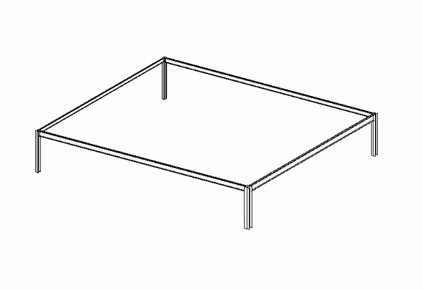

# ColorPipes

Complemento para colorir tubagens por diâmetro através de filtros na vista ativa do Revit.

## Estado do projeto

Implementação de filtros por diâmetro; o README anterior referia ColorSection, mas o código atual trata tubagens.

**`EraseFilters.cs` elimina filtros do documento, podendo afetar outras vistas, e não só os desta ferramenta.** O manifesto ainda aponta o comando de eliminação para `ColorSection`, não `ColorPipes`. O padrão de preenchimento usa o ID fixo `4`. Os binários antigos de ColorSection em `obj` não devem ser usados como distribuição deste projeto.

## Requisitos e preparação

- Windows, Autodesk Revit e as bibliotecas da API correspondentes à versão de compilação.
- Visual Studio com ferramentas de desenvolvimento .NET e targeting pack do **.NET Framework 4.8**.
- As referências atuais de [ColorPipes.csproj](ColorPipes.csproj) apontam para **Revit 2023**. Isto descreve a configuração existente, não uma certificação de compatibilidade com esta ou outras versões.

1. Clonar o repositório e abrir [ColorPipes.sln](ColorPipes.sln).
2. Conferir os caminhos de `RevitAPI.dll` e `RevitAPIUI.dll`, a versão de depuração e os eventos de compilação/limpeza. Alguns eventos copiam ou removem ficheiros na pasta de add-ins do utilizador.
3. Resolver as limitações de compilação/manifesto indicadas acima antes de tentar instalar. Compilar numa configuração de teste.
4. Conferir [ColorPipes.addin](ColorPipes.addin): a assembly e as classes devem coincidir com o projeto. Para um ensaio manual, colocar o manifesto em `%AppData%\\Autodesk\\Revit\\Addins\\2023` e apontar a assembly para a DLL compilada; incluir os recursos usados por `App.cs`.
5. Reiniciar o Revit e utilizar uma cópia de modelo descartável para a primeira execução.

## Funcionamento

Abrir uma vista que admita filtros e executar o comando. O código recolhe diâmetros distintos de tubagens do documento, cria regras de igualdade e nomeia filtros com `Ø` e o diâmetro convertido para milímetros. Cada grupo recebe uma cor aleatória.

## Organização do código

- [Command.cs](Command.cs): ponto de entrada e fluxo do comando.
- [ColorPipes.csproj](ColorPipes.csproj): referências, assembly e configuração de compilação.
- [ColorPipes.addin](ColorPipes.addin): registo do complemento no Revit.

Ficheiros de apoio: [EraseFilters.cs](EraseFilters.cs).

## Verificação

Testar diâmetros distintos, unidades de apresentação e filtros já existentes. Conferir o manifesto antes de instalar e verificar a utilização de filtros noutras vistas antes de eliminar.

Este README resulta da leitura do código em 11/11/2026; não foram executados build nem ensaios dentro do Revit. Não foi identificada uma suite de testes automatizados na árvore inspecionada. Quando há quantidades ou geometria de engenharia, verificar o funcionamento do software é distinto de validar as hipóteses e os resultados técnicos.

## Demonstração existente

A demonstração ilustra o projeto e não substitui os ensaios da versão atual.
